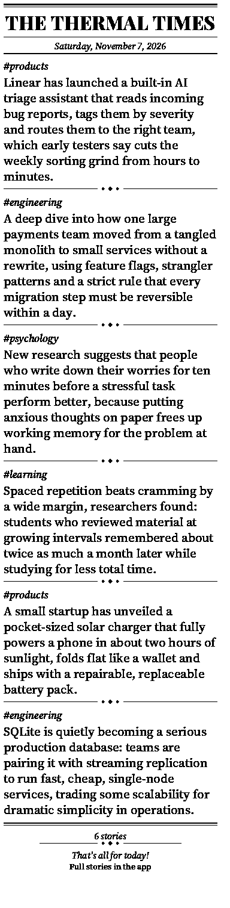

# thermal-news-printer

**Your daily news, printed on a cheap Bluetooth thermal "cat printer" and kept in an app.**

Every morning the app collects stories from your RSS feeds, lets a small AI model pick the most interesting
ones, writes a short, concrete TL;DR for each, and prints them as a little newspaper receipt, "The Thermal Times".
The app shows exactly that edition, and tapping a story opens the original article, so you can read anything that
caught your eye later.

<p align="center"></p>

Everything runs **on your Android phone**. You don't need a server.

> **Status:** active development. The phone-only app (Phase 6) runs on the phone today. Real-world testing of
> on-phone Bluetooth printing and scheduled prints is in progress. The Python implementation in `backend/` is the
> reference the app was ported from. See [Status](#status).

---

## How it works

```
 RSS feeds ──► fetch & dedupe ──► AI picks the edition ──► full text + AI TL;DR ──► render 384px ──► Bluetooth ──► 🧾
 (per category)  (SQLite)        (1 call, limits,          (only the chosen          1-bit receipt    cat printer
                                  never repeat)             stories)
```

### 1. Collecting the news
- You manage **categories** (e.g. `#products`, `#engineering`) and the **RSS feeds** in each one from the app.
  Defaults: Hacker News Launches and TechCrunch Startups (products), The Pragmatic Engineer (engineering),
  Freakonomics (psychology), Big Think (learning).
- Feeds are fetched with conditional requests (ETag / Last-Modified), so unchanged feeds cost almost nothing.
- Every article gets a **fingerprint**, a hash of its normalised URL with tracking parameters, fragments and
  trailing slashes stripped. The same story arriving through two feeds is stored once.
### 2. Picking the edition with AI
- **One AI call** looks at the recent, never-printed candidates (title plus a short snippet) and ranks the most
  interesting, substantive stories: launches, research findings, engineering deep dives, big non-political news.
  It skips listicles, promos and near-duplicates. The same call flags political stories.
- The code then applies the rules to the AI's ranking:
  - **The edition always has exactly "max items" stories** (Settings) whenever enough unseen, non-political
    stories exist. The **per-category limits** you set (e.g. max 3 `#products`, max 1 `#psychology`) are
    *preferences*: the AI's picks are taken within them first, then remaining picks, then the newest other
    stories round-robin across categories to fill the count. A limit of 0 (and disabled feeds) always excludes.
  - If the last 14 days cannot fill the edition, the window widens (30, 90 days, then no limit). Only when every
    unseen story is exhausted is the edition smaller, and the Feed says exactly why.
  - **It never prints the same news twice.** Anything that appeared in a successful (or in-progress) print is
    excluded. Headlines that are near-duplicates (word overlap ≥ 80%) of the last print, or of each other, are
    skipped too. If a print *fails*, those stories become eligible again, because they never reached paper.
- The result is the **next edition**. It is saved, and the **Feed**, the **Print Preview** and the printer all
  use exactly this edition. The app never shows the raw RSS firehose.
- Without an API key, or if the call fails, the app falls back to a deterministic pick: newest first, categories interleaved.

### 3. Summarising with AI
- Summaries use [OpenRouter](https://openrouter.ai) through the OpenAI-compatible API.
  The default model is `google/gemma-3-12b-it`, with an automatic fallback to `deepseek/deepseek-v4.1-flash`.
  You can switch either model, or type any OpenRouter model id, in Settings.
- **Only the chosen stories are summarised**: about 8 calls per edition, not one per article. That keeps it fast,
  cheap and light on battery.
- Some feeds only ship a one-line teaser. TechCrunch's RSS averages about 170 characters. For chosen stories like
  that, the app downloads the article page and extracts the main text (Readability), typically 3,000+ characters,
  so the AI has the real story to work with.
- **Strictly non-political.** A keyword pre-filter catches obvious cases cheaply and the curation call decides the
  rest. Political stories are never printed or shown.
- The prompt asks for 1–2 sentences of about 25–40 words (hard cap 250 characters) that **name the concrete
  subject** (the headline isn't printed), say what happened and give the single most important specific
  (a number, name or how it works), with no background. Filler like
  "explores", "discusses" and "sheds light" is banned, and a weak or over-long answer is retried once.

### 4. Rendering the receipt
- A canvas exactly **384 px wide** (48 mm at 203 dpi), as long as the content needs, **1-bit black and white**.
- Layout: the *The Thermal Times* masthead and the date between rules, then each story's `#tag` and TL;DR separated
  by a small diamond rule, then a short footer. There is no edition name or issue number.
- Content keeps a 6-dot left margin and a **22-dot right margin**, because the SC03h clips the right edge of a full
  384-dot row. The row is still sent as 48 bytes; only the drawing area is narrower (`PAD_R` in `mobile/src/render/layout.ts`).
- Newspaper typography with serif fonts: a *Playfair Display* masthead and *Source Serif 4* body text (both SIL OFL).
  Text is thresholded, not dithered, so it prints crisp.
- **Text only:** a plain `#tag` and the TL;DR, with no headlines, pills, boxes or illustrations.
  Every pixel of paper goes to news.
- The app's **Print Preview** shows the exact image that will be printed, so you can tune lengths without wasting paper.

### 5. Printing over Bluetooth

The printer side builds on **[rbaron/catprinter](https://github.com/rbaron/catprinter)** (MIT), which
reverse-engineered the BLE protocol these cheap printers (GB01, GB02, GT01, MX05… and our SC03h) use.
This project re-implements it, in Python (`backend/tnp/print/catprinter/`) and in TypeScript for the app
(`mobile/src/printer/`), and tests it byte for byte against the reference encoding.

How the protocol works:

- The printer exposes a BLE GATT service (`0xAE30`). The app **writes** commands to characteristic `0xAE01`
  and **listens** for notifications on `0xAE02`.
- Every command is a small packet:

  ```
  51 78 | cmd | 00 | len (2 bytes, little-endian) | payload | CRC-8 (poly 0x07) of payload | FF
  ```

- A print job is a sequence of commands: get device state → set quality → set energy (darkness) →
  *lattice start* → **one command per row of pixels** → feed paper → *lattice end* → get device state.
- Each row is 384 pixels = **48 bytes**, packed least-significant-bit first, 1 = burn (black).
  A row is sent either raw (`0xA2`) or run-length encoded (`0xBF`), whichever is shorter. Text-heavy
  receipts compress well.
- The job is streamed in small chunks with a short pause between them. The phone also honours the printer's
  flow control: `51 78 AE 01 01 00 10 70 FF` on `0xAE02` means "buffer full, pause" and
  `51 78 AE 01 01 00 00 00 FF` means "resume" (same bytes as the reference "ready"; it only counts as "job
  done" once all data is sent). Writes stop while paused, with a 5 s safety timeout.

Quirks of the **SC03h** that the reference doesn't cover (found on real hardware):

- **Dual-mode device:** it advertises classic Bluetooth serial as well as BLE. On Linux, BlueZ picks the
  classic connection and fails with `ProfileUnavailable`. The Python driver therefore opens a raw
  BLE ATT socket (`att.py`). Android's BLE stack connects over LE directly.
- It accepts a 247-byte MTU, but 244-byte writes stall the link. Chunks are capped at **100 bytes (and MTU - 3) with 10 ms pacing**.
- It never sends the reference "ready" notification. It only answers *get device state* (`0xA3`). Since a job
  starts and ends with that command, the **second `0xA3` reply** marks the job as finished.

**Print darkness.** Three things decide how dark a print comes out, and Settings > Printer > "Print darkness"
(Light / Normal / Dark / Darkest, default Dark) sets all of them:

- *Energy* (`0xAF`): heat per dot. Maximum (`0xFFFF`) for every level except Light.
- *Speed* (`0xBD`, sent before the rows): the lower the number, the faster the paper moves and the lighter the
  print. Presets are 24 / 32 / 36 / 40 for Light / Normal / Dark / Darkest. The phone-side protocol follows
  [NaitLee/Cat-Printer](https://github.com/NaitLee/Cat-Printer), which calls `0xBD` "set speed".
- *Ink weight* when rendering: Dark adds a thin outline to text and counts anti-aliased edge pixels as black
  (threshold 190 instead of 150); Darkest also switches to heavier serif weights (and so may wrap a bit
  differently). This stops thin serif hairlines from vanishing in the 1-bit conversion.

"Print darkness sample" prints a short sample with a solid bar, hairlines and a dot grid at the chosen level,
so you can compare levels on paper. If prints are still too light: charge the printer (a low battery prints
noticeably lighter) and use genuine thermal paper. Each print logs its level, energy and speed
(`[tnp] print level=... energy=... speed=...`) so you can confirm the saved level is the one used. The Light, Normal,
Dark and Darkest presets also send `0xA9` ("update device", as NaitLee does) after apply-energy.

### Troubleshooting uneven prints

Settings > Printer > "Print evenness test" prints six evenly spaced solid bands, a 50% checkerboard and 1px
hairlines. Read it like this:

- **Horizontal light bands** (often where dense detail is): the data stream stalls and the motor stops and
  restarts. Flow control and pacing address this; report it if it persists.
- **Gradual fade down the strip:** low battery or a hot head. Charge the printer fully.
- **Vertical streaks:** dirty print head. Clean it with isopropyl alcohol and a cotton swab.
- **Patchy or blotchy areas:** paper. Use genuine thermal paper with the shiny side against the head, and keep the lid closed.

To tell hardware from the phone, compare with the PC: `cd backend && uv run python -m tnp.print test`.

### 6. Scheduling
You set one or more print times in the app (e.g. 08:00 "Morning edition"). At each time, even with the app closed
or the phone idle, the phone fetches, summarises, picks the stories, renders and prints, then shows a notification
such as "Printed 6 stories". The phone must be within Bluetooth range of the printer (about 10 m) and the printer
switched on. A run that is more than 2 hours late is skipped rather than printing at a random time.

Under the hood a single exact Android alarm is armed for the next schedule; it starts a foreground service that runs
the whole pipeline in the background, and it is re-armed after every change, run and reboot. For this to be reliable
you must allow, once (Settings → Print schedule shows warnings with fix buttons):

1. **Alarms & reminders** (exact alarms) for Thermal News.
2. **Notifications** (Android 13+), so you can see progress and the outcome.
3. **Battery: Unrestricted / not optimised** for Thermal News. On OnePlus (OxygenOS) also open App info →
   Battery usage → *Allow background activity*, and enable *Auto launch* (Settings → Apps → Auto launch), otherwise the
   system may kill the app and swallow the alarm.

Use **Run schedule now (test)** to check the whole chain end to end.

---

## The app

React Native (Expo, TypeScript) with **Material You** theming that takes its colours from your wallpaper (Android 12+).

| Tab | What it does |
|---|---|
| **Feed** | The next edition (exactly what will print) with unread dots and per-card Mark as read/unread. **Fetch new news** moves the current stories to History, then fetches and curates a fresh edition; pull to refresh only checks for updates. Header shows "N of max stories · N unread" |
| **Preview** | The exact 384px receipt for the next edition |
| **History** | Archived editions (printed or rolled over by Fetch new news) grouped by day in collapsible sections (Today / Yesterday / date) with Printed / Not printed chips and read/unread cards |
| **Sources** | Add, edit and remove feeds and categories, and set per-category print limits |
| **Settings** | Print times and scheduled-printing status, models, OpenRouter key, printer pairing and test print, Print now, data source |

**Data source** (Settings): *On-device* (default, no server), *Remote backend* (point the app at the Python
backend, e.g. on a Raspberry Pi), or *Demo* (sample data).

---

## Getting started

### Tech stack and versions

| Part | Version |
|---|---|
| Expo SDK | 58 (`expo ~58.0.23`, `expo-router ~58.0.30`) |
| React Native / React | 0.88.1 / 19.3.0 (Hermes, New Architecture) |
| TypeScript | ~6.0.3 (strict) |
| UI | `react-native-paper` ^5.15 (Material 3) + `@pchmn/expo-material3-theme` ^1.4 (wallpaper colours) |
| Data | `expo-sqlite` ~58.0, `@tanstack/react-query` ^5.107, `expo-secure-store` ~58.0 |
| Feeds and full text | `fast-xml-parser` ^5.12, `@mozilla/readability` ^0.6, `linkedom` ^0.18 |
| Receipt rendering | `@shopify/react-native-skia` 2.14.0 |
| Bluetooth | `react-native-ble-plx` ^3.5 |
| Scheduling | local Expo module `modules/print-scheduler` (Kotlin, AlarmManager + foreground service) |
| Android | minSdk 24 · targetSdk 36 · compileSdk 37 · build-tools 37.0.0 · NDK 27.1.12297006 · Kotlin 2.2 · Gradle 9.4.1 |
| Python reference backend | Python ≥ 3.12 (tested on 3.14), managed by `uv` |

### Requirements
- An Android phone (Android 12+ for wallpaper colours; Android 16 tested) and a BLE cat printer (tested with **SC03h**).
- An [OpenRouter API key](https://openrouter.ai/keys). An edition costs well under a cent with the default model.
- To build:
  - Node.js 20+ (tested on 26) and npm.
  - **JDK 17**.
  - The Android SDK with platform 37, build-tools 37.0.0 and NDK 27.1.12297006. Android Studio installs these, or
    use `sdkmanager`.
  - Set `ANDROID_HOME`, e.g. `export ANDROID_HOME=$HOME/Android/Sdk`.
  - `adb` and a phone with **USB debugging** on (Developer options).
- Expo Go **won't** work, because Material You colours, Bluetooth, Skia and the alarm scheduler are native modules.
  You build your own APK.

### Build an APK

```bash
git clone <this repo> && cd thermal-news-printer/mobile
npm install
npx expo prebuild --platform android --clean      # generates android/ (gitignored)
cd android
```

**Release build (recommended for daily use).** The JavaScript is bundled and compiled to Hermes bytecode, so it is
fast and needs no computer once installed:
```bash
./gradlew assembleRelease -PreactNativeArchitectures=arm64-v8a
adb install -r app/build/outputs/apk/release/app-release.apk
```
The generated project signs release builds with the debug keystore, which is fine for installing on your own phone.
To publish, create your own keystore and set `signingConfigs.release` in `android/app/build.gradle`, or use EAS Build.

**Debug build (development, live reload).** It loads its JavaScript from the Metro dev server on your computer.
It is noticeably slower than a release build and needs the USB cable:
```bash
./gradlew assembleDebug -PreactNativeArchitectures=arm64-v8a
adb install -r app/build/outputs/apk/debug/app-debug.apk
cd .. && npx expo start --dev-client               # Metro
adb reverse tcp:8081 tcp:8081                     # phone reaches Metro over USB
```
Or let Expo do build, install and launch in one step: `npx expo run:android --variant release` (or without `--variant` for debug).

Build notes:
- `-PreactNativeArchitectures=arm64-v8a` builds only for 64-bit ARM phones, which covers nearly every phone from the
  last few years. That makes the build about 4× faster and the APK much smaller. Omit it for a universal APK.
- The first build takes about 5–10 minutes. Later builds are much faster.
- After adding or upgrading a **native** dependency, or changing `app.json` plugins or `modules/`, run
  `npx expo prebuild --platform android --clean` again and rebuild. Pure JavaScript changes only need Metro (debug)
  or a rebuild (release).
- Checks: `npx tsc --noEmit`, `npx expo lint`, `npx jest`, `npx expo-doctor`.

Troubleshooting:
- **`INSTALL_FAILED_VERIFICATION_FAILURE` or the install hangs (OnePlus/Oppo/Xiaomi):** enable *Install via USB*
  in Developer options, and accept the confirmation prompt on the phone.
- **`INSTALL_FAILED_UPDATE_INCOMPATIBLE`** when switching between debug and release: the signatures differ, so run
  `adb uninstall com.termalnewsprinter.app` first. This deletes the app's data.
- **App stuck on the splash screen (debug build):** Metro isn't reachable. Check that `npx expo start` is running
  and re-run `adb reverse tcp:8081 tcp:8081`.

### First run
1. **Settings → OpenRouter API key:** paste your key. It is stored in the phone's secure storage, never in the database or logs.
2. **Settings → Printer → Scan:** turn the printer on, pick it (e.g. `SC03h-…`), allow *Nearby devices*, then
   **Print test page**.
3. **Feed:** pull to refresh. The AI picks the next edition and its summaries appear within a minute.
4. Check **Preview**, then **Print now**, or wait for your scheduled time.
5. **Settings → Print schedule:** fix any warnings (exact alarms, notifications, battery) and try **Run schedule now (test)**.

### Optional: the Python backend
The original implementation still works on any Linux machine with Bluetooth (including a Raspberry Pi):
```bash
cd backend
uv sync
uv run python -m tnp.ingest                 # fetch feeds
OPENROUTER_API_KEY=... uv run python -m tnp.pipeline process   # summarise
uv run python -m tnp.print preview --out receipt.png            # render
uv run python -m tnp.print probe            # check the printer handshake (no paper)
uv run python -m tnp.print test             # print a test strip
uv run python -m tnp.api                    # REST API + scheduler on :8000
OPENROUTER_API_KEY=... uv run python -m tnp.ai.eval --n 8       # inspect TL;DR quality
```
Set `TNP_PRINTER=dry` to run everything without a printer. Run `uv run pytest -q` for the test suite.

---

## Repository layout
```
mobile/                 React Native app (Expo)
  src/core/             on-device pipeline: SQLite, RSS, AI curation, full text, OpenRouter, edition
  src/render/           384px receipt renderer (Skia)
  src/printer/          cat-printer BLE protocol + driver
  src/scheduler/        cron, alarm re-arming, background print task
  src/api/              data layer (on-device, remote backend, demo)
  src/app/              screens (expo-router)
  modules/print-scheduler/  native Kotlin module: exact alarms, foreground service, boot receiver
backend/                Python reference implementation (FastAPI, Pillow, BLE)
docs/
  ARCHITECTURE.md       data model, dedup rules, REST API
  MOBILE_ARCHITECTURE.md  phone-only module contracts
  sample_receipt.png
```

## Status
- ✅ Phone-only app: on-device SQLite, feed fetching, AI summaries with fallback (thinking disabled), Skia receipt
  renderer, BLE driver (byte-identical to the reference protocol) with flow control and darkness presets,
  exact-alarm scheduled prints, AI-curated editions of a guaranteed size (Feed = Preview = what prints), read/unread,
  Fetch new news, History grouped by day, Diagnostics, Material You UI. App test suite: 259 tests.
- ✅ Verified on real hardware: printing from the phone to an SC03h (OnePlus, Android 16).
- 🧪 Still being tuned on hardware: print evenness and darkness, the right-edge margin, and scheduled prints in Doze.
- ✅ Python reference backend: ingest, enrichment, summaries, dedup, renderer, BLE printing from Linux (raw ATT for
  dual-mode printers), REST API and scheduler. 360 tests. The receipt layout (no edition row, right margin) and the
  edition rules have since moved ahead in the app.

## Credits
- **[rbaron/catprinter](https://github.com/rbaron/catprinter)** by rbaron (MIT): the reverse-engineered BLE
  protocol this project's printer driver is based on.
- Fonts: [Playfair Display](https://github.com/google/fonts/tree/main/ofl/playfairdisplay) and
  [Source Serif 4](https://github.com/google/fonts/tree/main/ofl/sourceserif4) (SIL Open Font License).
- Summaries via [OpenRouter](https://openrouter.ai).

## License
MIT. See [LICENSE](LICENSE).
